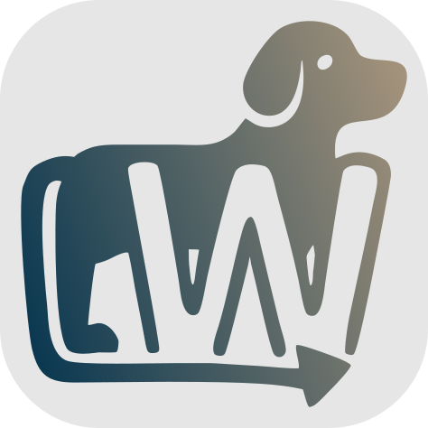

<p align="center">
    
</p>

# wag.run

Self-hosted workflow automation app built for collaboration. Build workflows on a visual canvas from triggers and actions, publish them as versions, and follow every run step-by-step. People participate in runs through approvals and tasks that land in their inbox.

Built with Laravel 13, Livewire 4, Flux, and [WireFlow](https://github.com/getartisanflow/wireflow) for the canvas.

## Features

- **Visual editor**: drag nodes from the palette, draw connections, right-click to copy, paste, or delete, undo and redo (⌘Z / ⇧⌘Z), and a data picker to insert earlier outputs into fields.
- **Drafts and versions**: edits stay in a draft until you publish. Each publish is a version, runs stay on the version they started with, and you can roll back or discard the draft.
- **Triggers**: manual (with inputs to fill in), webhook (optionally verified by token, HMAC signature, or IP allowlist), schedule (interval or cron), public or members-only forms, GitHub (new tag, new release, failed Actions run), by polling or a webhook registered on the repository, and Investbrain (new transaction).
- **Actions**: HTTP call, conditional logic, switch, for loop, while loop, wait, merge, terminate, compose, create file, update data store and update variable (set, append, and increment typed values that last between runs, or for one run), trigger another workflow, LLM call, send email and send notification, upload to S3, GitHub (create issue, comment, create release, run an Actions workflow), Google Sheets (add row), Investbrain (list portfolios, holdings, and transactions, get a holding or a quote, add a transaction, and export a backup), and wag.run's own API (list workspaces, list workflows, get workflow).
- **People in the loop**: approvals (one or more approvers, with an "approvals needed" count) and tasks with a form to fill in. They show up in the assignee's inbox and, unless they've turned email off in their notification preferences, by email.
- **Error handling**: per-node retries with backoff, and an optional "on error" path to catch a node that still fails.
- **Runs**: a live view of each run on the canvas with every step's input, output, and error. Retention is configurable for the whole install, per workspace, and per workflow.
- **Workspaces and roles**: Admin, Editor, Viewer, and Guest roles per workspace, plus admins for the whole install. A data store of typed values, encrypted secrets, and reusable credentials (HTTP basic, API token, AI provider, SMTP, and GitHub, Google, or any OAuth 2.0 provider connected through OAuth) belong to a workspace.
- **Sign-in**: email and password, passkeys, two-factor authentication, and OpenID Connect providers.
- **API and MCP server**: start and inspect runs from scripts with personal access tokens, or connect an AI assistant such as Claude to the MCP server through OAuth.
- **Audit log** of changes to workflows, secrets, members, and settings.

## Getting started

You need Docker with the Compose plugin. The app runs from a published image in one container (web server, queue workers, and scheduler) next to a PostgreSQL container.

```bash
mkdir wag.run && cd wag.run
```

```bash
curl -fsSLO https://raw.githubusercontent.com/wag-run/wag-run/main/docker-compose.yml
```

```bash
curl -fsSL https://raw.githubusercontent.com/wag-run/wag-run/main/.env.docker.example -o .env
```

Generate a database password, and copy the line it prints into `.env` in place of the empty `DB_PASSWORD=`. It's the only required setting:

```bash
echo "DB_PASSWORD=$(openssl rand -hex 24)"
```

```bash
docker compose up -d
```

Open <http://localhost:8080> and register. **The first account becomes the organization admin**, so do this before anyone else can reach the install. To upgrade, run `docker compose pull && docker compose up -d`.

[Self-hosting](docs/self-hosting.md) covers the rest: every setting, including `WAG_VERSION` to pin a release, HTTPS behind a reverse proxy, connecting GitHub and Google, backups, upgrades, running with SQLite or without Docker, building the image yourself, and how the containers are locked down.

## Development

See [Local development](docs/development.md) to set up a checkout. Run `php artisan boost:update` as part of that setup: it generates the AI agent skills into `.claude/skills`, which isn't committed.

```bash
php artisan test --compact   # the test suite
vendor/bin/pint              # code style
composer run types:check     # static analysis (Larastan)
```

Where things are:

| Path | What |
|---|---|
| `app/Engine` | The engine: coordinator, step runner, graph, templates, editor helpers, and nodes |
| `app/Services` | Workflows, assignments, invitations, mail, and workspace management |
| `resources/views/pages` | Livewire single-file page components |
| `database/seeders/DemoWorkflowSeeder.php` | The demo workflows |

## Extending

Nodes are PHP classes that extend `App\Engine\Node`: they declare their inputs, outputs, and ports, and do their work in `execute()`. Register them with the `NodeRegistry`, the way `App\Providers\WorkflowServiceProvider` registers the built-in nodes in `app/Engine/Nodes`. The editor, data picker, and validation pick them up automatically.

Credential types extend `App\Credentials\CredentialType` and are registered with the `CredentialTypeRegistry` in `App\Providers\AppServiceProvider`.

## License

wag.run is licensed under the [GNU Affero General Public License v3.0](LICENSE).
